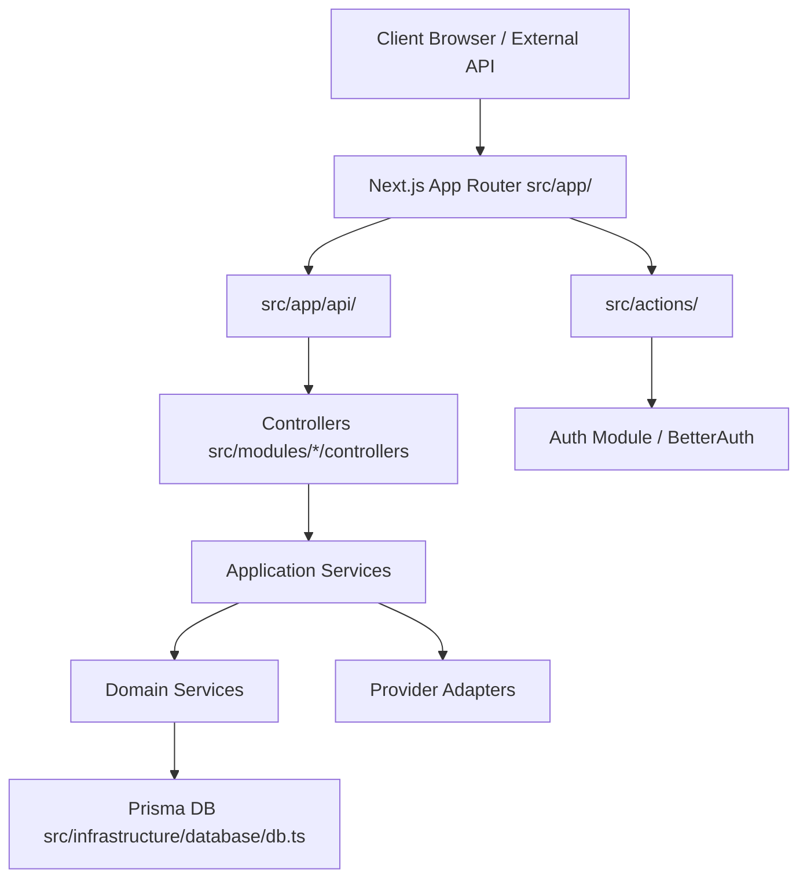
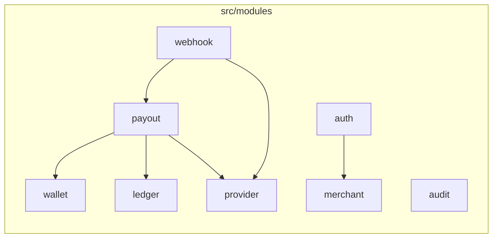

# 01 System Architecture

## Status Flags
* **[CURRENT / VERIFIED]**: Actual implementation.
* **[MISSING]**: Confirmed absent.
* **[OBSERVATION]**: Notable architectural patterns.

## Complete System Architecture

**[CURRENT / VERIFIED] Module & Directory Layout**
* `src/app/`: Next.js App Router (UI routes and API handlers).
* `src/actions/`: Server Actions handling UI forms (e.g., login, registration).
* `src/components/`: shadcn/ui and auth components.
* `src/modules/`: Domain-Driven Design boundaries (`audit`, `auth`, `ledger`, `merchant`, `payout`, `provider`, `wallet`, `webhook`).
* `src/infrastructure/`: Prisma DB client (`db.ts`), basic logger (`logger.ts`).
* `src/shared/`: Cross-cutting types and utilities.

## Controller Architecture

**[CURRENT / VERIFIED] Actual Dependency Direction**
HTTP Route Handler → Controller → Application Service → Domain Service → Infrastructure / Prisma

**[OBSERVATION] Direct Prisma Usage**
Domain Services (e.g., `payout.service.ts`, `ledger.service.ts`) import `db` directly from `src/infrastructure/database/db.ts`. No abstraction/Repository pattern is currently implemented.

**[OBSERVATION] PayoutController Mixed Responsibilities**
`src/modules/payout/controllers/payout.controller.ts` receives the NextRequest, validates via Zod, **manually executes authentication** (`authenticateApiKey`), **manually checks rate limits**, and then orchestrates `createPayout` and `dispatchPayout`. It handles cross-cutting edge concerns alongside API logic.

**[OBSERVATION] PayoutWebhookController Separation**
`src/modules/webhook/controllers/payout-webhook.controller.ts` cleanly extracts the raw body and delegates signature parsing to the Provider layer, followed by CAS transition execution via the Domain Service.

## Middleware Reality
**[MISSING] Absence of Middleware**
There is no `middleware.ts` in the project root or `src/`. Authentication, tenant isolation, and rate-limiting are explicitly executed inside individual controllers and actions, not at the edge.

## Final File/Module Architecture

