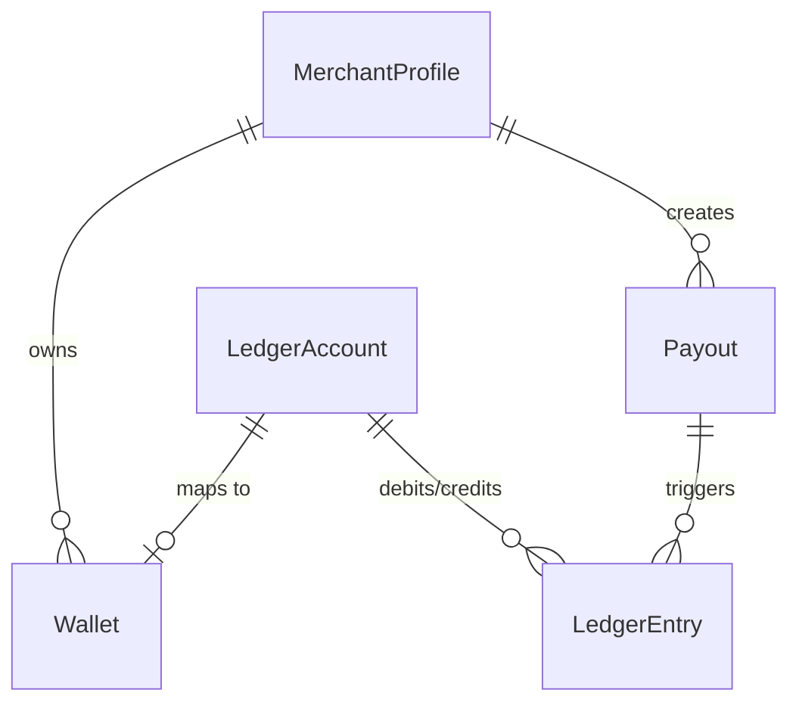
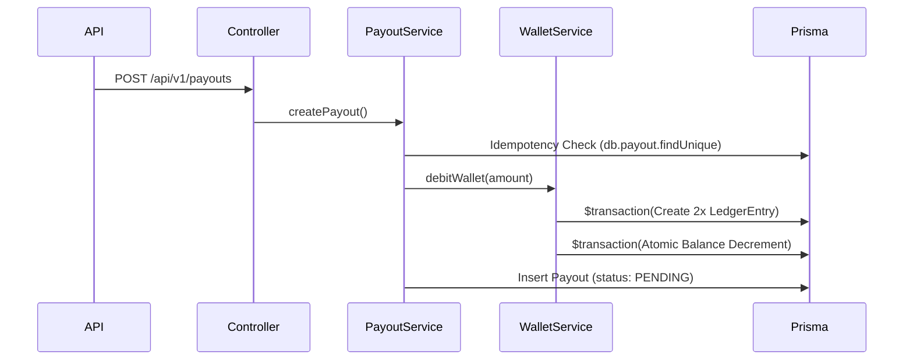
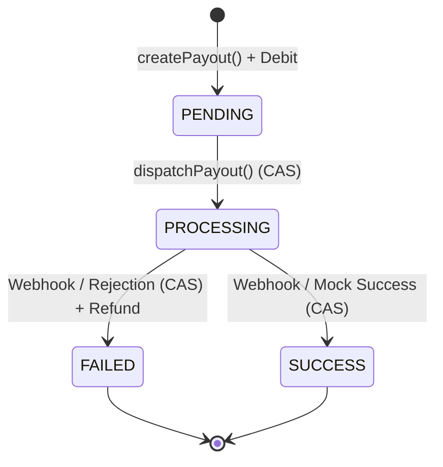

# 02 Financial Core

## Status Flags
* **[CURRENT / VERIFIED]**: Implemented and functioning.

## Tenancy and Ledger
**[CURRENT / VERIFIED] MerchantProfile Tenancy**
All financial activity is anchored to a `MerchantProfile`. Financial models (`Wallet`, `Payout`) enforce isolation via a mandatory `merchantProfileId` foreign key.

**[CURRENT / VERIFIED] Double-Entry Accounting**
* **Wallet**: Concrete balance tracker for a merchant.
* **LedgerAccount**: Abstract representations (e.g., Merchant Wallet, Escrow, Fees).
* **LedgerEntry**: Immutable double-entry row containing `debitAccountId` and `creditAccountId`.
Transactions strictly create paired double-entry records while utilizing Postgres decrement/increment constraints on the Wallet balance.

## Prisma Transaction Boundaries

**[CURRENT / VERIFIED] Atomic Balance Operations**
* **Wallet Debit**: Wrapped in a Prisma `$transaction`. Includes Idempotency check (`findUnique`), creating two `LedgerEntry` rows, and atomic `decrement` of the Wallet balance.
* **Wallet Credit/Refund**: Prisma `$transaction` inserting reversal `LedgerEntry` rows and atomic `increment` of the Wallet balance.

## Payout State Machine

**[CURRENT / VERIFIED] CAS State Transitions**
Payout state transitions are governed by Compare-And-Swap (CAS) logic. For example, a webhook transitioning a payout to `SUCCESS` requires a `WHERE status = 'PROCESSING'` constraint in Prisma.

* `PENDING`: Initial state upon DB insert.
* `PROCESSING`: Transitioned by Orchestrator before network dispatch.
* `SUCCESS`: Transitioned by Orchestrator (synchronous mock) or Webhook (asynchronous).
* `FAILED`: Transitioned by Webhook or immediate provider rejection.

