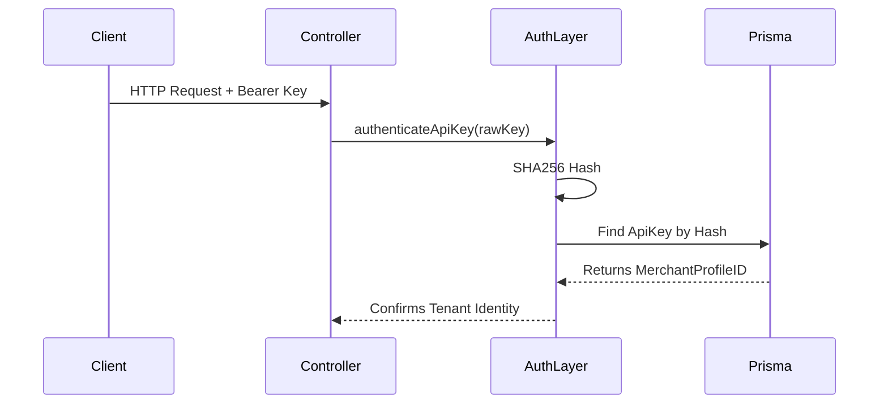

# 03 Security and Authentication

## Status Flags
* **[CURRENT / VERIFIED]**: Exists securely in code.
* **[PARTIAL]**: Partially implemented or stubbed.
* **[MISSING]**: Verified absent.

## Web Authentication
**[CURRENT / VERIFIED] Better Auth**
* **Mechanisms**: Utilizes Better Auth for Next.js web sessions, forms (Login, Register), and OAuth handling.
* **Storage**: Employs encrypted cookies and native session tables.

## Merchant API Authentication
**[CURRENT / VERIFIED] API-Key Hashing & Validation**
* API authentication is handled manually via the `authenticateApiKey()` function inside the `PayoutController`.
* **Flow**: Extracts `Authorization: Bearer X`, performs SHA256 hashing, checks `ApiKey.keyHash` in the DB.
* **Validation**: Explicitly checks `expiresAt` and `isActive` boolean states.
* **Tenant Isolation**: Returns the `merchantProfileId` explicitly, which is passed securely into downstream domain queries as mandatory `WHERE` clauses.

## Authorization & Guardrails
**[CURRENT / VERIFIED] Merchant Authorization**: Rooted strictly in tenant isolation via the `merchantProfileId`.
**[MISSING] Admin Authorization**: Schema supports associations to admins via the `User` table, but no route guards or admin UI exist to enforce or expose admin privileges.
**[PARTIAL] Rate Limiting**: The `PayoutController` manually invokes a rate-limiter function, but it is currently a completely empty pass-through stub.

## Explicit Contradiction: Idempotency vs Replay Protection
**[CURRENT / VERIFIED] Critical Clarification**
Legacy documentation incorrectly conflated two distinct security mechanisms.
1. **API Idempotency**: [CURRENT] Protects the `POST /api/v1/payouts` endpoint from duplicate processing. If a merchant sends the same `idempotencyKey` twice, the DB unique constraint and domain lookup block the duplicate *creation*.
2. **Webhook Replay Protection**: [MISSING] Webhooks use DB CAS to prevent applying the *financial side effects* of the same webhook twice. However, **there is currently no cryptographic timestamp validation** to block stale or infinitely replayed webhooks from executing compute resources. API idempotency does NOT protect webhooks.
