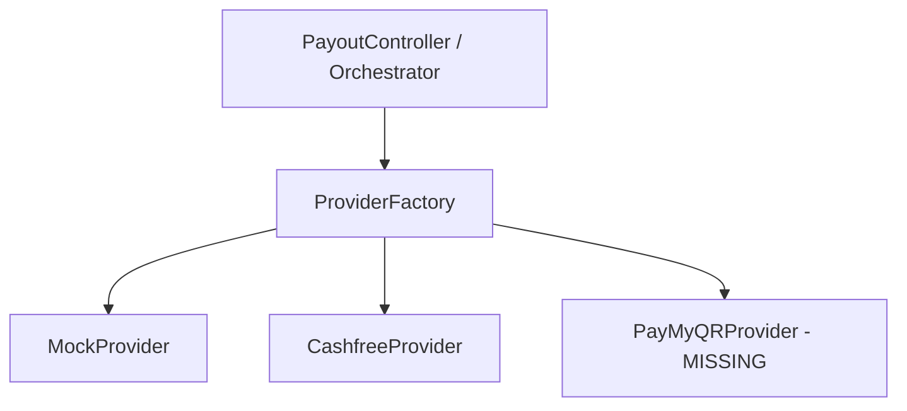
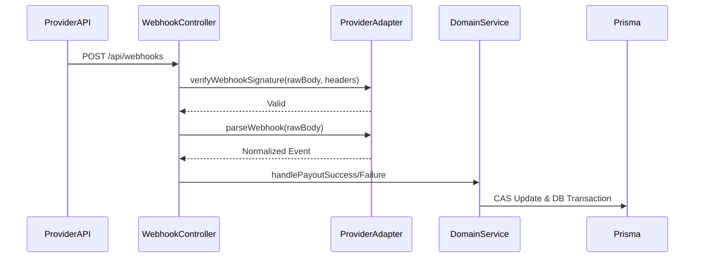

# 04 Providers and Webhooks

## Status Flags
* **[CURRENT / VERIFIED]**: Actual execution in code.
* **[PARTIAL]**: Lacking necessary constraints.
* **[MISSING]**: Verified absent.

## Provider Architecture
**[CURRENT / VERIFIED] Core Abstractions**
* **IPayoutProvider**: Strict interface defining `dispatch`, `verifyWebhookSignature`, and `parseWebhook`.
* **Provider Factory**: `getPayoutProvider()` dynamically resolves the adapter based on environment/config.

**[CURRENT / VERIFIED] Adapters**
* **Mock Provider**: Supports local testing with artificial latencies and static HMAC signature validation.
* **Cashfree Provider**: See `docs/providers/cashfree.md` for specific implementation limitations.

## Webhook Architecture
**[CURRENT / VERIFIED] Webhook Controller Flow**
* **Raw-body extraction**: `PayoutWebhookController` reads the Next.js stream as a raw string to preserve exact byte formatting for HMAC hashes.
* **HMAC Verification**: Delegates to `provider.verifyWebhookSignature()`.
* **Parsing**: `provider.parseWebhook()` normalizes external payloads into internal `ProviderWebhookEvent` objects.
* **CAS Transition**: Controller passes normalized event to `handlePayoutSuccess` or `handlePayoutFailure`. The DB executes a Compare-And-Swap (e.g., `WHERE status = 'PROCESSING'`) to prevent applying side-effects twice.

## Current Webhook Limitations
**[PARTIAL] Replay/Compute Limitation**
While the DB CAS mechanism prevents duplicate financial side effects (processing a `SUCCESS` twice), the webhook parsing layer **lacks timestamp/freshness protection**. An attacker intercepting a valid payload and HMAC signature can replay the HTTP request infinitely, forcing the server to expend compute validating hashes and querying the database. Timestamp freshness validation is **[MISSING]**.
