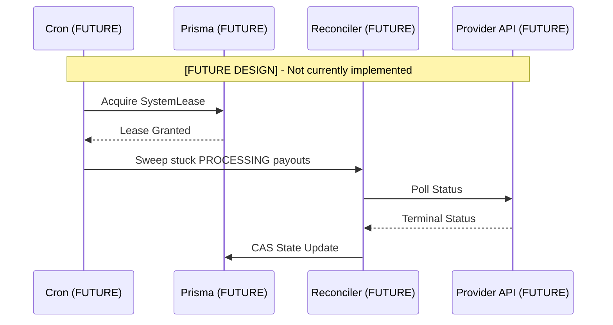

# 05 Reconciliation and Recovery

## Status Flags
* **[FUTURE DESIGN]**: Approved conceptual design, zero implementation exists in code.
* **[MISSING]**: Confirmed absent from current repository.

## Recovery Architecture (NOT IMPLEMENTED)

The concepts below are strictly **[FUTURE DESIGN]**. They do NOT exist in the current codebase, database schema, or infrastructure. 

### 1. Transactional Outbox [FUTURE DESIGN]
To ensure reliable communication with external providers, a Transactional Outbox pattern will eventually be needed.
* **Missing Entity**: `OutboxEvent` does not exist in `schema.prisma`.
* **Missing Logic**: The current Orchestrator directly dispatches network requests without an Outbox intermediary.

### 2. Distributed Locking [FUTURE DESIGN]
To prevent parallel crons from sweeping the same payouts simultaneously, distributed locks are required.
* **Missing Entity**: `SystemLease` does not exist in `schema.prisma`.

### 3. Background Job Infrastructure [FUTURE DESIGN]
* **Polling**: Currently, if a webhook is dropped, a payout remains permanently stuck in the `PROCESSING` state. There is no background polling loop implemented to rescue them.
* **Cron Executor**: No integration with Vercel Crons or similar execution environments currently exists.

## Future Visual Blueprint

The following diagram illustrates the intended architecture. It must not be confused with current implementation.

