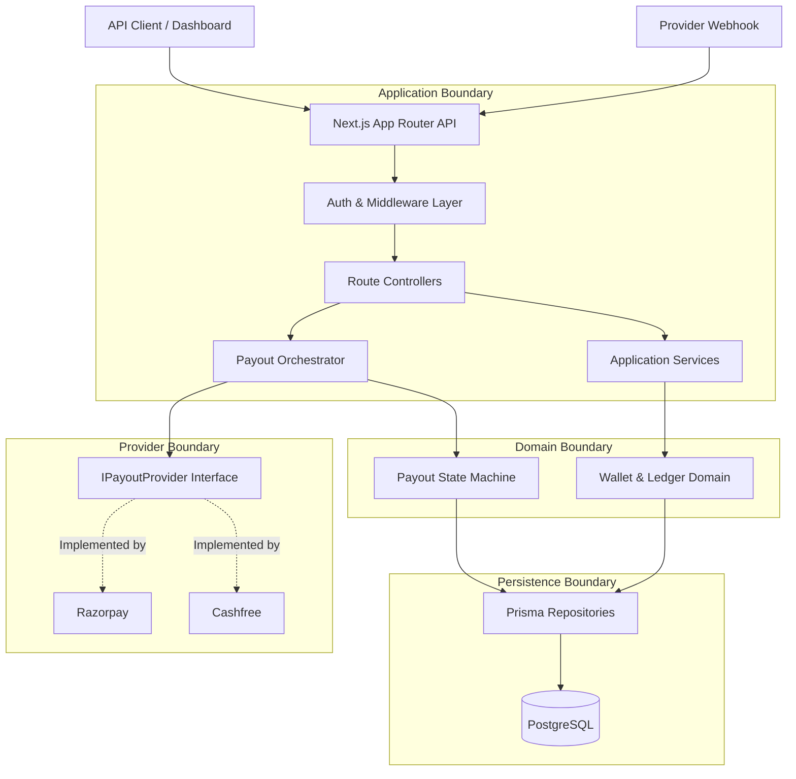

# System Architecture

PayERupee is designed as a **Modular Monolith** optimizing for developmental velocity and strict transactional boundaries without the premature complexity of distributed microservices.

## Conceptual Architecture



## Layer Responsibilities

### A. Routes (`src/app/api/...`)
- **Allowed:** HTTP request parsing, routing, response formatting.
- **Forbidden:** Financial business logic, direct DB mutations, direct provider calls.

### B. Middleware (`src/lib/api-auth.ts`)
- **Allowed:** API Key validation (SHA-256), rate limiting, request ID injection.
- **Forbidden:** Database updates, state transitions.

### C. Application Services & Orchestrators (`src/lib/orchestrators/...`)
- **Allowed:** Coordinating domains. The Orchestrator guarantees the Database Transaction commits BEFORE hitting the Provider Interface.
- **Forbidden:** Raw SQL, floating-point arithmetic.

### D. Domain Services (`src/lib/services/...`)
- **Allowed:** Wallet balance OCC rules, Ledger entry constraints, Payout status transitions.
- **Forbidden:** Network calls, HTTP concepts (req/res), provider-specific error mapping.

### E. Providers (`src/lib/providers/...`)
- **Allowed:** External API mappings, provider-specific signatures, mapping Razorpay/Cashfree statuses to standard `PayoutStatus`.
- **Forbidden:** Prisma client usage, triggering DB transactions.

### F. Repositories
- **Allowed:** Prisma persistence queries.
- **Forbidden:** HTTP logic, external provider calls.

## Final Source Tree Architecture

```text
src/
├── app/                  # [EXISTS] Next.js Route Handlers
│   └── api/
│       ├── v1/           # [EXISTS] REST API Endpoints
│       └── webhooks/     # [EXISTS] Provider Webhook Endpoints
├── config/               # [EXISTS] Env/Config
├── lib/
│   ├── api-auth.ts       # [EXISTS] Authentication logic
│   ├── db.ts             # [EXISTS] Prisma singleton & pool
│   ├── orchestrators/    # [EXISTS] Application Orchestration
│   ├── providers/        # [EXISTS] Provider Adapters (IPayoutProvider)
│   ├── services/         # [EXISTS] Core Financial Domain Logic
│   └── utils/            # [EXISTS] Shared utilities
├── schemas/              # [EXISTS] Zod validation schemas
├── tests/                # [EXISTS] Integration tests
└── workers/              # [PLANNED - Phase 6] Background cron/bullmq
```

*(Note: We deliberately avoid heavy Nest.js-style nested module structures in favor of flat, explicit modular boundaries.)*
