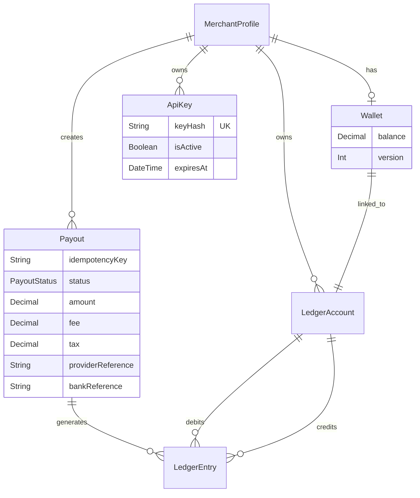

# Database & Transaction Architecture

## ER Diagram (Phase 1-4 Baseline)



## Financial Invariants

1. **Double-Entry Ledger:** `LedgerEntry` always requires a `debitAccountId` and a `creditAccountId`. The amount must be strictly positive `> 0`.
2. **OCC (Optimistic Concurrency Control):** `Wallet` updates require `version: currentVersion`, natively preventing race-condition double spends.
3. **Immutability:** Once a `LedgerEntry` or `Payout` terminal state is written, it is mathematically permanent.

## Database Transaction Boundary

**CRITICAL RULE:** Database transactions and external HTTP network calls must never intertwine.

### Incorrect (Forbidden) Architecture
```text
BEGIN TRANSACTION
  Update Wallet
  Create Ledger
  HTTP POST to Razorpay  <-- 🛑 DANGER: Connection pool held hostage to network latency
  Update Payout Status
COMMIT
```

### Correct (Implemented) Architecture
```text
BEGIN TRANSACTION
  Update Wallet
  Create Ledger
  Update Payout (PROCESSING)
COMMIT                  <-- ✅ Safe: DB Connection released in < 5ms.

HTTP POST to Provider   <-- ✅ Safe: Executed entirely in Node.js memory.

BEGIN TRANSACTION
  Update Payout (SUCCESS/FAILED)
  [Compensating Ledger if FAILED]
COMMIT
```
