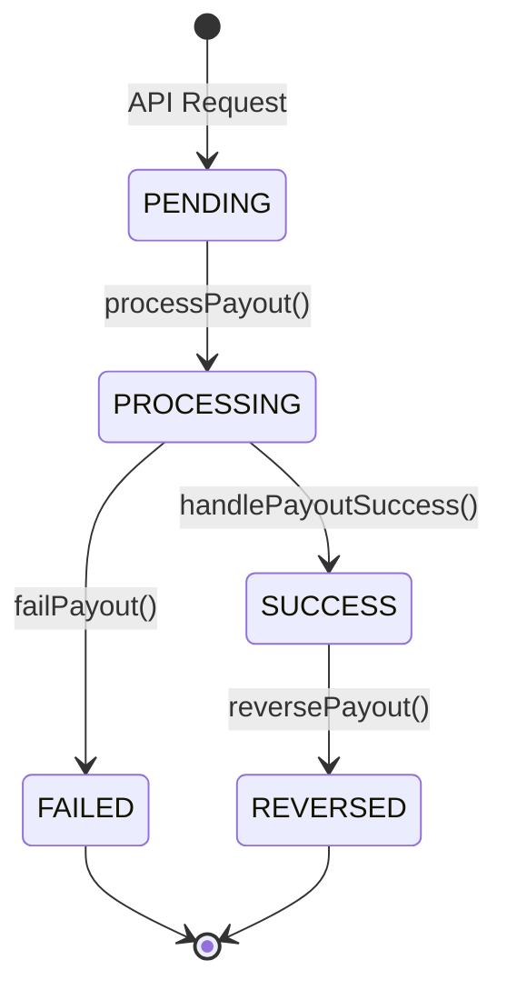

# Payout Lifecycle

The entire lifecycle revolves around a strict state machine preventing illegal transitions.

## State Machine

## Step-by-Step Lifecycle

1. **API Request:** Client hits `/api/v1/payouts`.
2. **Idempotency Check:** DB constraint checks `@@unique([merchantProfileId, idempotencyKey])`. Duplicate requests safely return the existing object.
3. **PENDING Creation:** Payout is logged in the DB as `PENDING`.
4. **PROCESSING Transition:** The orchestrator atomically deducts the Wallet and creates Principal/Fee Ledger entries. Payout moves to `PROCESSING`.
5. **Provider Dispatch:** The orchestrator calls `IPayoutProvider.dispatch()`.
6. **Ambiguous Provider Response (Timeout):** If the provider request fails with a network timeout, the state remains permanently in `PROCESSING`. The funds are safely secured. **WE NEVER AUTO-FAIL A TIMEOUT.**
7. **Definitive Failure:** If the provider responds immediately with a 400 validation error, we transition `PROCESSING -> FAILED`, refund the Wallet, and create reversal Ledger entries.
8. **Webhook / Reconciliation:** Later, a webhook (or a cron job calling `.status()`) resolves the `PROCESSING` state into `SUCCESS` or `FAILED`.
9. **Late Reversals:** If a `SUCCESS` payout bounces days later from the clearinghouse, a webhook triggers `reversePayout()`, performing identical refund math.

## Exactly-Once Guarantees

- **Exactly-Once Deduction:** You cannot deduct funds from a Payout unless its status is explicitly `PENDING`.
- **Exactly-Once Refund:** You cannot refund a Payout unless its status is explicitly `PROCESSING` (for failure) or `SUCCESS` (for late reversal).
