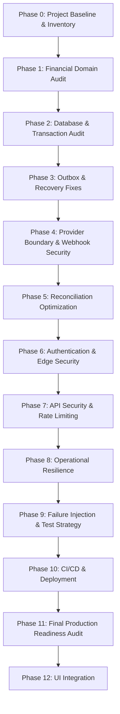

# Master Roadmap
**Date:** 2026-08-23

## Dependency Graph

## Phase Ordering Rationale
* **Phase 3 (Outbox & Recovery Fixes)** must happen before **Reconciliation Optimization** because the orchestrator currently leaves failed inline dispatches in `PENDING` state, starving the Reconciler for 24 hours.
* **Provider Boundary & Webhooks** must be verified simultaneously to ensure signatures and references map cleanly.
* **UI Integration** is strictly isolated to Phase 12, ensuring backend APIs are hardened, tested, and idempotent before any frontend touches them.

## Roadmap Breakdown
1. **PHASE 0  — Project Baseline & Inventory** (CURRENT)
2. **PHASE 1  — Financial Domain Audit**
3. **PHASE 2  — Database & Transaction Audit**
4. **PHASE 3  — Outbox & Recovery Fixes** (Will fix TS compilation bug and Liveness bug).
5. **PHASE 4  — Provider Boundary & Webhook Security**
6. **PHASE 5  — Reconciliation Optimization**
7. **PHASE 6  — Authentication & Edge Security**
8. **PHASE 7  — API Security & Rate Limiting**
9. **PHASE 8  — Operational Resilience**
10. **PHASE 9 — Failure Injection & Test Strategy**
11. **PHASE 10 — CI/CD & Deployment**
12. **PHASE 11 — Final Production Readiness Audit**
13. **PHASE 12 — UI Integration**
